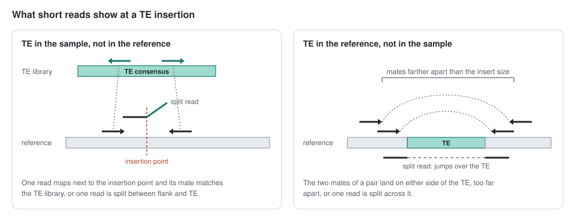
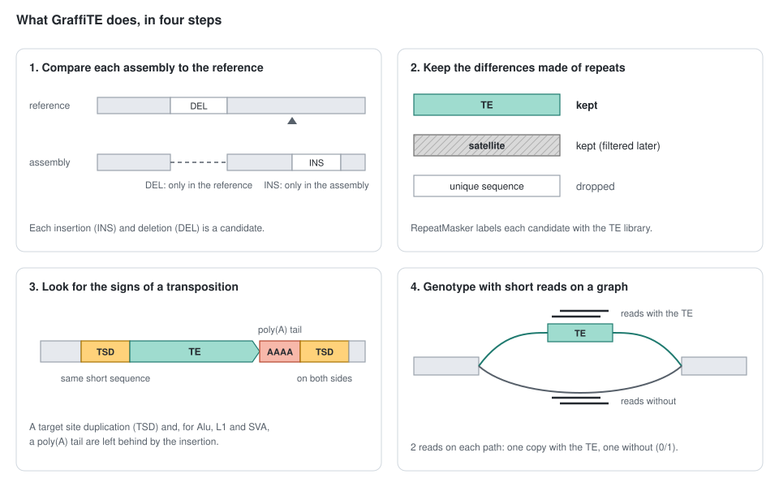
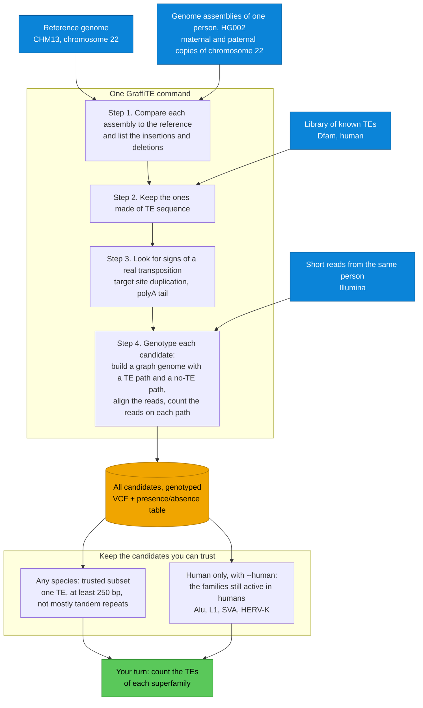
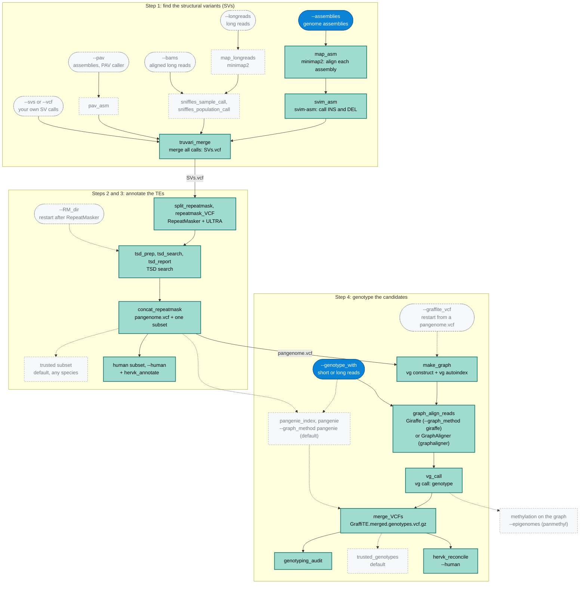
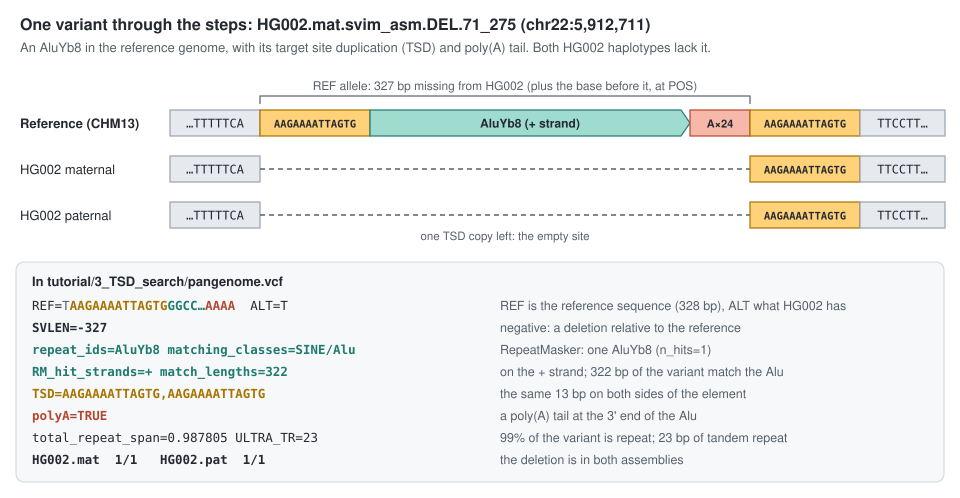
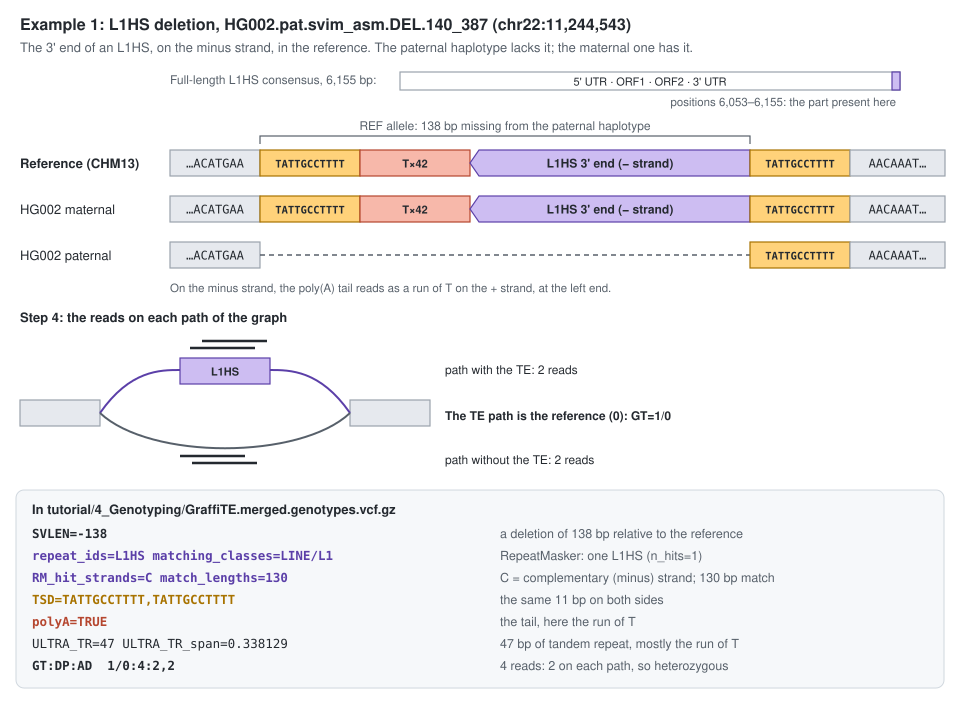
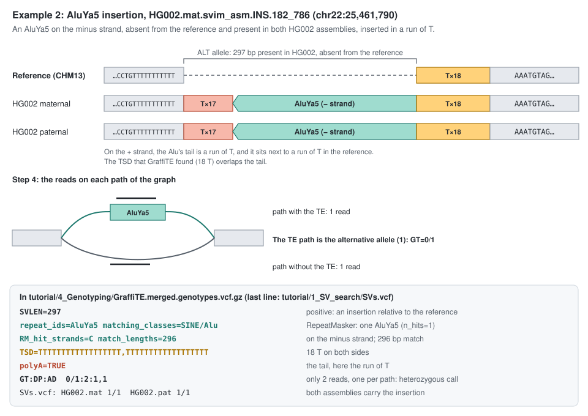
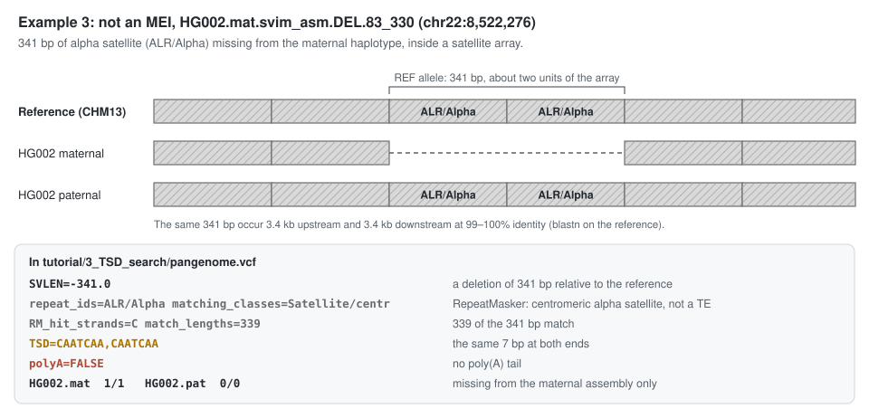

# Practical 3: Genotyping of mobile element insertions (MEIs) in a TE graph-genome with `GraffiTE`

**Tutorial Author:** Clément Goubert (`goubert.clement@gmail.com`)

**Last Update**: November 3, 2026 (`GraffiTE` v1.1.0.0)

## Background

### TE insertion polymorphisms

- We call insertion polymorphism TEs copies that are segregating between individuals (usually at population scale). Many names have been given: MEI (mobile element insertion), polyTE, TIP (transposon insertion polymorphism), pME (polymorphic mobile element),... In this tutorial we use MEI, the most widely adopted term.

- I like to make a distinction between MEI call (presence/absence) and MEI genotype (homozygous or heterozygous).

- MEIs can be useful for a wide variety of applications: as marker in population genetics, to search for evidence of selection, or in association studies such as GWAS or molecular-QTL (~quantitative GWAS).


> Figure 1. Different use cases for MEIs.

- MEIs are mainly found by comparing sequencing data (short-reads, long-reads or alternative genome assemblies) to a reference genome. Thus an MEI can be either an INSertion or a DELetion relative to the reference genome. 

- Most methods are focusing on short-reads, as these data are abundant and cost-effective. Using short-reads, the general strategy consist of searching for discordant read pairs (1 read mapped to a location, another elsewhere far beyond the expected insert size), and/or split reads (split-reads are read partially mapping to a location). Figure 2 shows the two signals that short-read methods look for.


> Figure 2. What short reads show at a TE insertion: read pairs with one mate in the TE, and reads split at the insertion point. Simplified from Figure 2 of [Chen et al., 2022](https://link.springer.com/protocol/10.1007/978-1-0716-2883-6_4).

- Many methods... The main limitation is that read length, and insert sizes are often smaller than the targeted TEs. Thus, long-read approaches or hybrid approaches (combining both) are more sensitive. Long reads and genome assemblies allows better detection of MEIs, but there is less data available, and starting from assembled genomes also depends on assembly quality (but this is improving very quickly!)

> Table 1. Main approaches for finding MEIs. The tools listed are examples, not a complete list. \* preprint.

| Approach | Example software | Pros | Cons |
|---|---|---|---|
| **Short-read mapping** | MELT, Mobster, RetroSeq, TEMP2, xTea, MEGAnE, INSurVeyor, TEforest\*; McClintock runs several of these | ✓ most of the available data<br>✓ fast<br>✓ many methods, some tested on thousands of genomes | ✗ breakpoints only, not the TE sequence<br>✗ false negatives<br>✗ weaker for long TEs and in repeated regions |
| **Long-read mapping** | tldr, TELR, PALMER, rMETL, xTea (long-read mode), MEHunter, TrEMOLO (OUTSIDER module), LOCATE\* | ✓ reads contain the whole TE sequence<br>✓ reads span most insertions<br>✓ some find rare or somatic insertions | ✗ can be slow<br>✗ most report insertions only<br>✗ fewer datasets than short reads |
| **Assembly to reference** | TrEMOLO (INSIDER module), Pannagram\*; or SVIM-asm or PAV followed by RepeatMasker | ✓ whole TE sequence and both breakpoints<br>✓ usually fast (minimap2) | ✗ allele dropout: an unphased assembly can miss one allele of a heterozygous site<br>✗ depends on assembly quality<br>✗ no genotypes for samples without an assembly |
| **Graph genotyping** | vg (Giraffe + vg call), PanGenie, Paragraph, BayesTyper | ✓ short reads can map to the allele with the TE and to the allele without it<br>✓ genotypes many samples from short reads | ✗ finds no new variants: needs a list of SVs from another approach<br>✗ does not annotate TEs<br>✗ building the graph and its indexes takes time and memory |

- One common limitation to most methods, is that the evaluation of the presence/absence of a TE, and their allelic state (homozygous or heterozygous) is based on mapping statistics over a reference genome, that only carries one of the two possible alleles (presence or absence of the TE). This is not only true for TEs, but it applies as well to all large (>50bp) structural variants (SV). In the recent years, pangenome-based approaches, and in particular graph-genomes allow to represent at the same time multiple alleles for a given loci. Several read mappers have been developed to be used with graph-genomes, which have dramatically increased the accuracy of SV and TE genotyping. 


> Figure 3. Pangenomes and Structural Variation.

## Description

[`GraffiTE`](https://github.com/cgroza/GraffiTE) is a pipeline that finds polymorphic mobile element insertions (MEIs) by comparing genome assemblies or long read datasets to a reference genome, and then genotypes the discovered polymorphisms in read sets using a graph-genome representation of the MEIs. GraffiTE is made as a toolbox, containing different modules that can be combined to make the best of the user's data. `GraffiTE` is build as a [`Nextflow`](https://www.nextflow.io/index.html) pipeline and runs every step in an [`Apptainer`](https://apptainer.org/) (formerly Singularity) container that holds its dependencies. This tutorial uses `GraffiTE` v1.1.0.0 ([documentation](https://cgroza.github.io/GraffiTE/)).

The pipeline is divided in 4 main steps:

- **Step 1:** Search of structural variants (SVs) between alternative assemblies (or long-reads sets) and the reference genome
- **Step 2:** Filtering of SVs to retain likely repeats (candidate MEIs)
- **Step 3:** Target site duplication (TSD) and TE-specific feature search
- **Step 4:** Graph-genotyping of MEIs using short or long read sets

In this tutorial, we will demonstrate the basic usage of GraffiTE by searching for MEIs between the individual HG002 and the telomere-to-telomere reference genome CHM13v2.0. **We will first compare a diploid assembly of HG002 (T2T HG002 v1.1, maternal and paternal haplotypes) to the reference genome CHM13v2.0 to identify candidate MEIs**. The list of candidate MEIs will be used to create a TE graph-genome, where each MEI sequence (TE-present haplotype) is represented a bubble (alternative path) in the graph. **To validate each candidate MEI, we will then map short reads (Illumina) onto the TE graph-genome, and infer their genotypes (i.e. heterozygosity) by comparing the read support between TE-absent (short paths) and TE-present (bubbles, long path) in the graph**.

`GraffiTE` runs these four steps with a single command. We will run it once, then discuss the outputs and how to interpret them.

The practical at a glance:



> **Genotyping method used in this practical: `Giraffe`.** We will genotype the short reads by aligning them to the graph with [`Giraffe`](https://www.science.org/doi/10.1126/science.abg8871) and calling genotypes with `vg call` (`--graph_method giraffe`). For short reads, `GraffiTE` uses [`PanGenie`](https://www.nature.com/articles/s41588-022-01043-w) by default, and `PanGenie` is the better choice for short reads. As `GraffiTE` runs it, `PanGenie` asks for 17 GB of memory per run. For 20 students at once that would be 340 GB, and the course server has 62 GB. In our test, genotyping with `Giraffe` used at most 2.4 GB.


> Steps 1 to 3: detection of candidate MEIs between the diploid assembly of HG002 and the reference genome

<br>


> Step 4: graph-genotyping of the MEIs

> These two figures were drawn in 2023, when the reference was hg38.

### Objectives

At the end of this tutorial, you should be able to:

- Understand the general principle of the `GraffiTE` method 
- Perform a simple analysis using assemblies to search for candidate MEIs and use short-reads to validate and genotype each polymorphism
- Explore and interpret the outputs of `GraffiTE`
- Choose the subset of results to work with: the trusted subset for any species, or the human subset with `--human`


## Protocol

### Overview
*In order to speed-up the analyses during this tutorial, we will focus on the chromosome 22 only.*

The following workflow shows the main steps of the pipeline, as we run it in this practical:



<details><summary>You can click here to reveal a more detailed workflow</summary>
<p>



The whole `GraffiTE` v1.1 pipeline, by `Nextflow` process. Green boxes are the processes this practical runs, blue boxes its inputs, and dashed grey boxes the other options. Dashed arrows are the paths this practical does not take. Drawn from the [process graph](https://cgroza.github.io/GraffiTE/reference/processes/) of the `GraffiTE` documentation.

</p>
</details>

### Input data

First, let's create a directory for this practical

```
mkdir practical3
cd practical3
```

The directory `/data/practical3_graffite/input` contains all the files we will need for the execution of the program. We will first create a symlink to it, and check its content.

```
ln -s /data/practical3_graffite/input/ input
```

```sh
tree input/
```

```
input/
├── HG002.100k.Illumina.fastq.gz
├── HG002.assemblies.csv
├── HG002.mat.chr22.fa
├── HG002.pat.chr22.fa
├── HG002.reads.csv
├── Homo_sapiens_DFAM3.9_040926.fa
└── chm13v2.0.chr22.fa

1 directory, 7 files
```

1. **Assemblies list:** `HG002.assemblies.csv`

This file indicate which assemblies to use, their path and name

```sh
cat input/HG002.assemblies.csv
```

```
path,sample
/data/practical3_graffite/input/HG002.mat.chr22.fa,HG002.mat
/data/practical3_graffite/input/HG002.pat.chr22.fa,HG002.pat
```

The two assemblies are chromosome 22 of the maternal and paternal haplotypes of the [T2T HG002 v1.1 assembly](https://github.com/marbl/hg002).

2. **Reference genome:** `chm13v2.0.chr22.fa`, chromosome 22 of the [T2T CHM13v2.0](https://github.com/marbl/CHM13) reference.

3. **Reads file list:** `HG002.reads.csv`

This file indicate which read set to use, their path and sample name
In this case, there is only one read sample:

```
cat input/HG002.reads.csv
```

```
path,sample
/data/practical3_graffite/input/HG002.100k.Illumina.fastq.gz,HG002
```
> The read set holds 100,000 HG002 Illumina reads from the test data shipped with `GraffiTE`. Due to time constraint, we use this small read set: most candidate MEIs will get too few reads to be genotyped (see [Outputs](#outputs)).

4. **TE library:** `Homo_sapiens_DFAM3.9_040926.fa`

This file contains the consensus sequences for human repeats from [Dfam](https://dfam.org/) 3.9, in the version distributed for `GraffiTE`.

### Resource settings for the course server

On November 3, 2026, the course server had 16 CPUs and 62 GB of memory, shared by the whole class. The command below uses these options to keep each run small:

- `-qs 1`: `Nextflow` runs one task at a time for you (by default it starts as many tasks as the machine has CPUs).
- `--cores 2`: each task uses at most 2 threads. `RepeatMasker`, inside `GraffiTE`, does not follow this setting: in our test it used about 5 CPUs for under 2 minutes.
- `--stSort_m 1G --stSort_t 2`: memory per thread and number of threads for `samtools sort` after aligning each assembly. With the defaults (`4G` and `4` threads), each sort can use up to 16 GB. On the smaller server used for earlier tests (15 GB), `samtools` failed with these defaults (`couldn't allocate memory for bam_mem`).
- `--make_graph_memory 4G`: the memory requested to build the graph. With the default (`40G`), one student's task would reserve two thirds of the server's memory.

In our test, with nobody else running, the largest task (`repeatmask_VCF`) used 3.4 GB of memory.

### Running GraffiTE

`GraffiTE` runs all four steps with one command:

```sh
nextflow run /opt/graffite/main.nf \
  --assemblies input/HG002.assemblies.csv \
  --reference input/chm13v2.0.chr22.fa \
  --TE_library input/Homo_sapiens_DFAM3.9_040926.fa \
  --genotype_with input/HG002.reads.csv \
  --graph_method giraffe --human \
  --out tutorial \
  -qs 1 --cores 2 --stSort_m 1G --stSort_t 2 --make_graph_memory 4G
```

> The run takes about 18 minutes. In our tests on November 3, 2026, with nobody else running, it took 17 min 42 s, from the instructor's account and from a student account alike. With the whole class running at once it will take longer; we have not measured how much.

> **If you stop the run.** If your instructor asks you to stop `GraffiTE` (`Ctrl + C`), or if it fails, use the results of a finished run instead. In your `practical3` directory:
>
> ```sh
> mv tutorial tutorial_interrupted
> ln -s /data/practical3_graffite/precomputed/tutorial tutorial
> ```
>
> If `mv` says that `tutorial` does not exist, run the `ln` command alone. The shared results are read-only, and every command below works on them.

While the program is running, we can look at the command in detail:

- `/opt/graffite/main.nf` is the `GraffiTE` v1.1.0.0 pipeline installed on the server. Its container image is already on the server, so `Nextflow` does not download anything.
- `--assemblies`: the input table `HG002.assemblies.csv`, which lists the path and sample name of each assembly of HG002.
- `--reference`: the reference genome.
- `--TE_library`: the TE consensus sequences.
- `--genotype_with`: the input table of read sets to genotype, here one Illumina read set of HG002 (in `GraffiTE` versions before 1.1, this option was called `--reads`).
- `--graph_method giraffe`: align the reads to the graph with `Giraffe` and genotype with `vg call` (see the note on `PanGenie` in the [Description](#description)).
- `--human`: keep a subset of the candidates made of the TE families still polymorphic in humans (Alu, LINE-1, SVA and HERV-K). **Use it only for human data.** For any other species, leave it out: `GraffiTE` then writes a *trusted* subset instead (see [Results for any species](#while-graffite-runs-results-for-any-species)).
- `--out`: the directory where to write the outputs.
- `-qs 1 --cores 2 --stSort_m 1G --stSort_t 2 --make_graph_memory 4G`: the resource settings described [above](#resource-settings-for-the-course-server). `-qs` has a single `-` because it is a `Nextflow` argument, while the others are pipeline-specific.

> Older versions of this tutorial used `--mammal`. In `GraffiTE` v1.1 the LINE-1 5' inversion and SVA VNTR checks run on every dataset, and `--mammal` has no effect.

`Nextflow` subdivides each step of the pipeline into *processes*. While the pipeline runs, it prints the status of each process.

<details><summary>You can click here to reveal the run divided by `Nextflow` process</summary>
<p>

| Step | Process | What it runs | Time in our test |
|---|---|---|---|
| 1 | `map_asm` | `minimap2`: aligns each assembly to the reference | 4 min 38 s per assembly, one after the other |
| 1 | `svim_asm` | `svim-asm`: calls insertions and deletions in each assembly | 7 s per assembly |
| 1 | `truvari_merge` | `truvari collapse`: merges the SVs of both assemblies into `SVs.vcf` | 7 s |
| 2 | `split_repeatmask`, `repeatmask_VCF` | `RepeatMasker` and `ULTRA` on the SV sequences | 1 min 43 s |
| 3 | `tsd_prep`, `tsd_search`, `tsd_report` | the TSD search, in 10 batches | 1 min 30 s |
| 3 | `concat_repeatmask` | writes `pangenome.vcf` and its subset | 3 s |
| 3 | `hervk_annotate` | `--human` only: HERV-K annotation | 4 s |
| 4 | `make_graph` | `vg construct` and `vg autoindex`: builds the TE graph-genome | 2 min 50 s |
| 4 | `graph_align_reads` | `vg giraffe` and `vg pack`: aligns the reads to the graph | 44 s |
| 4 | `vg_call` | `vg call`: genotypes each candidate from the aligned reads | 1 min 4 s |
| 4 | `merge_VCFs`, `genotyping_audit`, `hervk_reconcile` | merge the genotypes with the annotations, and write the human subset (`--human` only) | about 2 s |

Aligning the two assemblies takes half of the run.

</p>
</details>

### While GraffiTE runs: results for any species

`--human` only applies to human data. For any other species, you would run the same command without it, and `GraffiTE` would write a **trusted subset**: the candidates made of a single repeat, at least 250 bp long, less than 60% tandem repeats, and with `FILTER=PASS` from the SV caller. Nothing in this rule is specific to humans.

We ran `GraffiTE` on the same data without `--human`. Its results are in `/data/practical3_graffite/run_without_human`:

```sh
ls /data/practical3_graffite/run_without_human/*
```

```
/data/practical3_graffite/run_without_human/3_TSD_search:
TSD_full_log.txt
TSD_summary.txt
pangenome.presence-absence.tsv
pangenome.presence-absence_trusted.tsv
pangenome.trusted.vcf
pangenome.vcf

/data/practical3_graffite/run_without_human/4_Genotyping:
GraffiTE.merged.genotypes.presence-absence_trusted.tsv
GraffiTE.merged.genotypes.trusted.vcf.gz
GraffiTE.merged.genotypes.trusted.vcf.gz.tbi
GraffiTE.merged.genotypes.vcf.gz
genotyping_record_audit.tsv
```

- `3_TSD_search/pangenome.vcf` holds every candidate. `pangenome.trusted.vcf` is its trusted subset.
- `4_Genotyping/GraffiTE.merged.genotypes.vcf.gz` holds the genotypes of every candidate. `GraffiTE.merged.genotypes.trusted.vcf.gz` is its trusted subset.
- Each subset comes as a VCF and as a presence/absence table (`.tsv`). The table is easier to open in R, Python or a spreadsheet.

The exact rule of the trusted subset is written in the header of the VCF, on its last `##bcftools_viewCommand` line:

```sh
grep '##bcftools_viewCommand' /data/practical3_graffite/run_without_human/3_TSD_search/pangenome.trusted.vcf | tail -1
```

```
##bcftools_viewCommand=view -Ov -o pangenome.trusted.vcf -i '(n_hits==1 & abs(SVLEN)>=250 & (ULTRA_TR_span<0.6 | matching_classes="Simple_repeat")) & FILTER="PASS"' pangenome.vcf; Date=Thu Oct 29 17:29:34 2026
```

The presence/absence table has one row per candidate, the TE annotation in columns 1 to 21, and one column per sample. Here are its first rows with a genotype, with some columns:

```sh
awk -F'\t' 'NR == 1 || $22 != "NA"' /data/practical3_graffite/run_without_human/4_Genotyping/GraffiTE.merged.genotypes.presence-absence_trusted.tsv | \
  cut -f 1,2,4,6,9,10,20,21,22 | head -8 | column -t
```

```
CHROM  POS       ID                              SVLEN   repeat_ids  matching_classes  TSD                                polyA  HG002
chr22  3930828   HG002.mat.svim_asm.DEL.57_244   -291    ACRO1       Satellite/acro    GAGACTG,GAGACTG                    FALSE  0
chr22  4543234   HG002.pat.svim_asm.INS.74_257   344     AluYa5      SINE/Alu          AAAAATACATGTATAC,AAAAATACATGTATAC  TRUE   0
chr22  5912711   HG002.mat.svim_asm.DEL.71_275   -327    AluYb8      SINE/Alu          AAGAAAATTAGTG,AAGAAAATTAGTG        TRUE   0
chr22  8701047   HG002.mat.svim_asm.DEL.84_339   -23970  ALR/Alpha   Satellite/centr   NA                                 FALSE  0
chr22  11705131  HG002.mat.svim_asm.INS.108_390  1354    ALR/Alpha   Satellite/centr   CCAC,CCAC                          FALSE  0
chr22  11772448  HG002.pat.svim_asm.DEL.141_391  -1534   ALR/Alpha   Satellite/centr   AAATATCTTCC,AAATATCTTCC            FALSE  0
chr22  12131310  HG002.mat.svim_asm.DEL.100_396  -680    ALR/Alpha   Satellite/centr   NA                                 TRUE   1
```

In the sample column, `1` means the TE is present in that sample, `0` that it is absent, and `NA` that there was no genotype. `GraffiTE` converts the genotype for you: a positive `SVLEN` is an insertion (the TE is absent from the reference), a negative `SVLEN` a deletion (the TE is in the reference). For an insertion, `1` means at least one of the two copies of the chromosome carries the TE. For a deletion, `1` means both copies still carry it, like the reference.

Now count the candidates of each repeat class, and whether HG002 carries them:

```sh
awk -F'\t' 'NR > 1 {print $10, $22}' /data/practical3_graffite/run_without_human/4_Genotyping/GraffiTE.merged.genotypes.presence-absence_trusted.tsv | sort | uniq -c
```

```
      4 LINE/L1 NA
      1 LTR/ERV1 NA
      1 Retroposon/SVA 0
      1 Retroposon/SVA NA
     14 SINE/Alu 0
      3 SINE/Alu 1
      7 SINE/Alu NA
      1 Satellite/acro 0
     14 Satellite/acro NA
     93 Satellite/centr 0
      6 Satellite/centr 1
    222 Satellite/centr NA
      1 Simple_repeat NA
```

336 of the 368 trusted records are satellites, from the centromere (`Satellite/centr`) and the short arm (`Satellite/acro`) of chromosome 22. The trusted rule keeps every repeat class except simple repeats and low-complexity sequences, so satellites pass it. To keep only the TE classes, filter on the `matching_classes` column:

```sh
awk -F'\t' 'NR == 1 || $10 ~ /^(LINE|SINE|LTR|DNA|RC|Retroposon)/' \
  /data/practical3_graffite/run_without_human/4_Genotyping/GraffiTE.merged.genotypes.presence-absence_trusted.tsv > trusted_TEs.tsv
```

In another species, adapt the list of classes to the TEs of your organism and to the names used in your TE library.

### Outputs

When the run is over, `GraffiTE` has written its results in `./tutorial` (`--out tutorial`). We have been cheating a little bit by using a very tiny input read set (100,000 reads). In our test run, 902 of the 906 records in the final VCF carry the `FILTER` value `lowad` (fewer than 2 reads support the allele), and 609 have no genotype (`./.`). Keep this in mind when reading the genotypes below.

#### 1. Output organization

Each step of the pipeline writes at least one file in variant call format (`VCF`):

```sh
tree -L 2 tutorial/
```

```
tutorial/
├── 1_SV_search
│   ├── SVs.vcf                                   # all INS and DEL, one genotype column per assembly
│   └── svim-asm_individual_VCFs                  # INS and DEL of each assembly
├── 2_Repeat_Filtering
│   └── 1                                         # one directory per reference contig (here, only chr22)
├── 3_TSD_search
│   ├── TSD_full_log.txt                          # detailed output of the TSD search
│   ├── TSD_summary.txt                           # one line per candidate
│   ├── hervk_*                                   # HERV-K annotation (--human only)
│   ├── human_filter_summary.txt                  # what --human kept and dropped
│   ├── pangenome.human.consolidated.vcf          # HERV-K loci merged (--human only)
│   ├── pangenome.human.vcf                       # the human subset of pangenome.vcf
│   ├── pangenome.presence-absence.tsv            # pangenome.vcf as a table
│   ├── pangenome.presence-absence_human.tsv      # pangenome.human.vcf as a table
│   └── pangenome.vcf                             # every candidate, annotated
├── 4_Genotyping
│   ├── GraffiTE.merged.genotypes.human.vcf.gz    # genotypes of the human subset
│   ├── GraffiTE.merged.genotypes.human.vcf.gz.tbi
│   ├── GraffiTE.merged.genotypes.vcf.gz          # genotypes of every candidate
│   ├── genotyping_record_audit.tsv               # what happened to each candidate during genotyping
│   ├── hervk_reconciliation_report.md            # (--human only)
│   └── hervk_unconsolidated_records.vcf          # (--human only)
├── GraffiTE_alignments                           # read alignments to the graph
└── GraffiTE_graph                                # the TE graph-genome and its indexes
```

(The `tree` output has no comments; we added them.) Because we used `--human`, the trusted files you saw in `/data/practical3_graffite/run_without_human` are not here: `GraffiTE` writes one subset or the other.

- `1_SV_search/SVs.vcf` contains all the INS and DEL variants found between each assembly and the reference genome. It contains many SVs that are not TE-related.
- `2_Repeat_Filtering/1/genotypes_repmasked_filtered.vcf` contains the INS and DEL variants for which at least 80% of their sequence is occupied by repeats (`RepeatMasker` hits plus tandem repeats found by `ULTRA`).
- `3_TSD_search/pangenome.vcf`: the same variants with additional fields for TSDs and polyA tails.
- `4_Genotyping/GraffiTE.merged.genotypes.vcf.gz`: the genotypes of every candidate, from the mapping of the read set.

#### 2. Following one variant through the steps

- Let's count the total number of SVs (including non-TE SVs) detected by `svim-asm` after analyzing both assemblies (step 1). The SV type (`DEL` or `INS`) is part of each variant's ID (column 3):

   ```sh
   grep -v '#' tutorial/1_SV_search/SVs.vcf | cut -f 3 | grep -o 'svim_asm\.[A-Z]*' | sort | uniq -c
   ```

   ```
       493 svim_asm.DEL
       462 svim_asm.INS
   ```

- Now, let's count the number of variants retained after TE and TSD annotation (steps 2 and 3):

   ```sh
   grep -v '#' tutorial/3_TSD_search/pangenome.vcf | cut -f 3 | grep -o 'svim_asm\.[A-Z]*' | sort | uniq -c
   ```

   ```
       464 svim_asm.DEL
       439 svim_asm.INS
   ```

- Let's look at one of these variants before annotating TEs (step 1):

   ```sh
   grep -v '#' tutorial/1_SV_search/SVs.vcf | grep -w 'HG002.mat.svim_asm.DEL.71_275'
   ```

   ```
   chr22	5912711	HG002.mat.svim_asm.DEL.71_275	TAAGAAAATTAGTGGGCCGGGCGCGGTGGCTCACGCCTGTAATCCCAGCACTTTGGGAGGCCGAGGCGGGTGGATCATGAGGTCAGGAGATCGAGACCATCCTGGCTAACAAGGTGAAACCCCGTCTCTACTAAAAATACAAAAAAAATTAGCCGGGCGCGGTGGCGGGCGCCTGTAGTCCCAGCTACTCAGGAGGCTGAGGCAGGAGAATGGCGTGAACCCGGGAAGCGGAGCTTGCAGTGAGCCGAGATTGCGCCACTGCAGTCCGCAGTCCCGCCTGGGCGACAGAGCGAGACTCCGTCTCAAAAAAAAAAAAAAAAAAAAAAAA	T	.	PASS	SVLEN=-327.0	GT	1/1	1/1
   ```
   > `GraffiTE` made this file by merging the variants found in each assembly with [`truvari`](https://github.com/ACEnglish/truvari). Columns 1 to 9 give information about each variant. Columns 10 and 11 are the genotype fields for each assembly (`HG002.mat` and `HG002.pat`, in the order of the `#CHROM` header line). Because each assembly represents one haplotype, the genotype is `1/1` when the variant is found in that assembly. `svim-asm` found this deletion in both haplotypes.

- Now let's look at the same variant after the annotation steps:

   ```sh
   grep -v '#' tutorial/3_TSD_search/pangenome.vcf | grep -w 'HG002.mat.svim_asm.DEL.71_275' | cut -f 1-3,6-11
   ```

   ```
   chr22	5912711	HG002.mat.svim_asm.DEL.71_275	.	PASS	SVLEN=-327.0;n_hits=1;fragmts=1;match_lengths=322;repeat_ids=AluYb8;matching_classes=SINE/Alu;RM_hit_strands=+;RM_hit_IDs=2324;L1_5PINV=None;total_match_length=324;total_match_span=0.987805;ULTRA_TR=23;ULTRA_TR_span=0.070122;total_repeat_span=0.987805;TSD=AAGAAAATTAGTG,AAGAAAATTAGTG;polyA=TRUE	GT	1/1	1/1
   ```
   > We used `cut` to hide the `REF` and `ALT` sequences. `GraffiTE` added several fields to the INFO column: the TE family found by `RepeatMasker` (`repeat_ids=AluYb8`, `matching_classes=SINE/Alu`), the fraction of the variant covered by TEs and tandem repeats (`total_repeat_span`), the TSD (`TSD=`) and whether a polyA tail was found (`polyA=TRUE`).

   

#### 3. Genotypes' VCF

Let's explore in more detail the file `4_Genotyping/GraffiTE.merged.genotypes.vcf.gz`. It is compressed with `bgzip`, so we read it with `zcat`. VCFs files start with a header with each line starting with a `#`.

- Column names:

```
zcat tutorial/4_Genotyping/GraffiTE.merged.genotypes.vcf.gz | grep '^#CHROM'
```

```
#CHROM	POS	ID	REF	ALT	QUAL	FILTER	INFO	FORMAT	HG002
```

In our case, there is only one sample column (`HG002`). If more read sets are used (for example for multiple individuals), there will be one sample column per read set.

- Genotypes: the genotype (`GT`) is the first field of the sample column.

```
zcat tutorial/4_Genotyping/GraffiTE.merged.genotypes.vcf.gz | grep -v '^#' | cut -f 10 | cut -d: -f 1 | sort | uniq -c
```

```
    609 ./.
     43 0/0
      7 0/1
     11 1/0
    236 1/1
```

`./.` means no genotype. `0/1` and `1/0` are both heterozygous. `0` is the reference allele and `1` the alternative allele (columns `REF` and `ALT`).

The details for each column, and each field within columns, are in the [documentation](https://cgroza.github.io/GraffiTE/reference/vcf-fields/).

To make sense of it, let's look at some entries. We use `cut` to hide the `REF` and `ALT` sequences.

- **Example 1: L1HS deletion**

   ```sh
   zcat tutorial/4_Genotyping/GraffiTE.merged.genotypes.vcf.gz | grep -w 'HG002.pat.svim_asm.DEL.140_387' | cut -f 1-3,6-10
   ```

   ```
   chr22	11244543	HG002.pat.svim_asm.DEL.140_387	35.6601	lowad	LV=0;CH=0;RC=chr22;RS=11244543;RD=11244682;DP=4;AT=>375961>375962>375963>375964>375965>375966>375967,>375961>375967;SVLEN=-138;n_hits=1;match_lengths=130;repeat_ids=L1HS;matching_classes=LINE/L1;fragmts=1;RM_hit_strands=C;RM_hit_IDs=2411;total_match_length=132;total_match_span=0.94964;L1_5PINV=None;ULTRA_TR=47;ULTRA_TR_span=0.338129;total_repeat_span=0.94964;TSD=TATTGCCTTTT,TATTGCCTTTT;polyA=TRUE	GT:DP:AD:GL:GQ:GP:XD:MAD	1/0:4:2,2:-4.51934,-1.43116,-4.51934:30:-1.10024:2.14058:1
   ```

   Using the `INFO` column flags, we can see that 130 bp of this 138 bp deletion (`SVLEN=-138`, a deletion relative to the reference) match the *L1HS* family (`repeat_ids=L1HS`) of the LINE/L1 order (`matching_classes=LINE/L1`), on the complementary strand (`RM_hit_strands=C`). GraffiTE found a TSD (`TSD=TATTGCCTTTT,TATTGCCTTTT`, the 5' and 3' copies) and a polyA tail (`polyA=TRUE`).

   The fields from `LV=` to `AT=` come from the genotyping step: they give the variant's place in the graph (`LV` to `RD`), the read depth (`DP`) and the graph path of each allele (`AT`). In the genotype column, `GT` is `1/0`, from 4 reads (`DP=4`), 2 supporting each allele (`AD=2,2`).

   

- **Example 2: AluYa5 insertion**

   ```sh
   zcat tutorial/4_Genotyping/GraffiTE.merged.genotypes.vcf.gz | grep -w 'HG002.mat.svim_asm.INS.182_786' | cut -f 1-3,6-10
   ```

   ```
   chr22	25461790	HG002.mat.svim_asm.INS.182_786	33.0945	lowad	LV=0;CH=0;RC=chr22;RS=25461790;RD=25461791;DP=2;AT=>827440>827451,>827440>827441>827442>827443>827444>827445>827446>827447>827448>827449>827450>827451;NumCollapsed=1;CollapseId=689.0;NumConsolidated=1;SVLEN=297;n_hits=1;match_lengths=296;repeat_ids=AluYa5;matching_classes=SINE/Alu;fragmts=1;RM_hit_strands=C;RM_hit_IDs=874;total_match_length=298;total_match_span=1;L1_5PINV=None;ULTRA_TR=17;ULTRA_TR_span=0.057047;total_repeat_span=1;TSD=TTTTTTTTTTTTTTTTTT,TTTTTTTTTTTTTTTTTT;polyA=TRUE	GT:DP:AD:GL:GQ:GP:XD:MAD	0/1:2:1,1:-4.91889,-2.17567,-2.82167:6:-1.3038:0.180628:0
   ```

   This 297 bp insertion relative to the reference (`SVLEN=297`) is an *AluYa5* (`repeat_ids=AluYa5`, `matching_classes=SINE/Alu`) with a TSD and a polyA tail. It got only 2 reads, one for each allele: `GT` is `0/1` with `DP=2` and `AD=1,1`.

   

   > `GraffiTE` searches every record for LINE-1 insertions with a 5' inversion. When it finds one, the `L1_5PINV` field holds the `RepeatMasker` ID of the inverted hit instead of `None`. None of the records in this practical has one.

- **Example 3: not an MEI**

   ```sh
   grep -v '#' tutorial/3_TSD_search/pangenome.vcf | grep -w 'HG002.mat.svim_asm.DEL.83_330' | cut -f 1-3,8
   ```

   ```
   chr22	8522276	HG002.mat.svim_asm.DEL.83_330	SVLEN=-341.0;n_hits=1;fragmts=1;match_lengths=339;repeat_ids=ALR/Alpha;matching_classes=Satellite/centr;RM_hit_strands=C;RM_hit_IDs=2340;L1_5PINV=None;total_match_length=341;total_match_span=0.997076;ULTRA_TR=0;ULTRA_TR_span=0.0;total_repeat_span=0.997076;TSD=CAATCAA,CAATCAA;polyA=FALSE
   ```

   This 341 bp deletion is made of centromeric alpha satellite (`repeat_ids=ALR/Alpha`, `matching_classes=Satellite/centr`), not a transposable element. `GraffiTE` keeps satellites in `pangenome.vcf`: its repeat filter counts every `RepeatMasker` class except `Simple_repeat` and `Low_complexity`. 335 of the 903 records in `pangenome.vcf` are centromeric satellites (`Satellite/centr`). To leave them out, filter on the TE classes in other species (see [Results for any species](#while-graffite-runs-results-for-any-species)), or use `--human` for human data.

   

#### 4. The human subset

In humans, three groups of TEs are still active: Alu (AluY subfamilies), LINE-1 (L1HS) and SVA (SVA_D, SVA_E and SVA_F). One endogenous retrovirus, HERV-K (HML-2), also has copies that are present in some people and absent in others. `--human` keeps the candidates from these subfamilies that pass a few more checks (one element, at least 250 bp, a polyA tail for Alu, L1 and SVA). `human_filter_summary.txt` lists what it kept:

```sh
sed -n '/^records in/,/^dropped/p' tutorial/3_TSD_search/human_filter_summary.txt
```

```
records in pangenome.vcf       : 903
records in pangenome.human.vcf : 28 (HERV-K annotation is added downstream by hervk_annotate)

kept (count, matching_classes, repeat_ids):
     14 SINE/Alu	AluYa5
      5 SINE/Alu	AluYb8
      4 LINE/L1	L1HS
      1 Simple_repeat	SVA_E(VNTR_only)
      1 SINE/Alu	AluYg6
      1 SINE/Alu	AluY
      1 Retroposon/SVA	SVA_F
      1 Retroposon/SVA	SVA_D

dropped MEI-class records (count, matching_classes, repeat_ids):
```

No HERV-K candidate passed on this chromosome.

One record is labelled `SVA_E(VNTR_only)`. SVA elements contain a region with a variable number of tandem repeats (VNTR), which can [change in copy number, in a way comparable to microsatellites](https://www.ncbi.nlm.nih.gov/pmc/articles/PMC2945828/). When two haplotypes carry the same SVA and differ only in the length of its VNTR, there is no new insertion. `GraffiTE` labels these records `(VNTR_only)` and gives them the class `Simple_repeat`, so we count them apart from the SVA insertions.

The presence/absence table of the human subset has one column per assembly, because it comes from step 3, before genotyping:

```sh
cut -f 1,2,4,6,9,10,22,23 tutorial/3_TSD_search/pangenome.presence-absence_human.tsv | head -6 | column -t
```

```
CHROM  POS       ID                              SVLEN  repeat_ids  matching_classes  HG002.mat  HG002.pat
chr22  4543234   HG002.pat.svim_asm.INS.74_257   344    AluYa5      SINE/Alu          0          1
chr22  5737450   HG002.pat.svim_asm.INS.75_268   324    AluYa5      SINE/Alu          1          1
chr22  5912711   HG002.mat.svim_asm.DEL.71_275   -327   AluYb8      SINE/Alu          0          0
chr22  16741086  HG002.pat.svim_asm.DEL.290_703  -342   AluYa5      SINE/Alu          1          0
chr22  17900865  HG002.mat.svim_asm.INS.164_724  332    AluYb8      SINE/Alu          1          1
```

The first AluYa5 is in the paternal haplotype only. The AluYb8 we followed above (`DEL.71_275`) is in the reference but in neither haplotype of HG002.

Finally, summarize the genotyped human subset for each superfamily. For each record, the command counts how many of the two copies of chromosome 22 carry the TE, from the genotype and the sign of `SVLEN`:

```sh
zcat tutorial/4_Genotyping/GraffiTE.merged.genotypes.human.vcf.gz | grep -v '^#' | \
  awk -F'\t' '
  { match($8, /matching_classes=[^;]*/); sf = substr($8, RSTART + 17, RLENGTH - 17)
    if ($8 ~ /VNTR_only/) sf = "SVA_VNTR_only"
    match($8, /SVLEN=[^;]*/); len = substr($8, RSTART + 6, RLENGTH - 6) + 0
    split($10, f, ":"); gt = f[1]
    if (gt ~ /\./) col = "no_call"
    else { alt = gsub(/1/, "1", gt); col = (len > 0 ? alt : 2 - alt) " copies" }
    n[sf]++; t[sf, col]++ }
  END { print "superfamily", "records", "TE_on_0_copies", "TE_on_1_copy", "TE_on_2_copies", "no_call"
        for (sf in n) print sf, n[sf], t[sf, "0 copies"] + 0, t[sf, "1 copies"] + 0, t[sf, "2 copies"] + 0, t[sf, "no_call"] + 0 }' | \
  column -t
```

```
superfamily     records  TE_on_0_copies  TE_on_1_copy  TE_on_2_copies  no_call
LINE/L1         4        0               0             0               4
Retroposon/SVA  2        1               0             0               1
SVA_VNTR_only   1        0               0             0               1
SINE/Alu        21       9               4             1               7
```

With 100,000 reads, 13 of the 28 records got no genotype, including all four L1HS.

- Compare the ratio of Alu, L1 and SVA candidates (21/4/2 in `human_filter_summary.txt`) with the literature, e.g.: [Sudmant et al., 2015](https://www.nature.com/articles/nature15394) and [Watkins et al., 2020](https://academic.oup.com/gbe/article/12/6/779/5828221).

<!-- TODO(author): the 2023 version compared its counts (35/8/3) with these papers and discussed why LINE-1 and SVA were more frequent than in short-read surveys. Rewrite that interpretation for the --human counts (21 Alu, 4 L1, 2 SVA, 1 SVA VNTR-only, no HERV-K). -->

To know more about the `--human` filter, see [Human mobile element insertions](https://cgroza.github.io/GraffiTE/guides/human-mei/) in the `GraffiTE` documentation.


#### Cleaning the `Nextflow` work directory

`Nextflow` creates a `work/` directory which includes all the intermediate files (about 1 GB for this practical). This is useful to resume an interrupted job. When successful, it is recommended to remove this directory to save on storage.

```
rm -rf work/
```
------

🎉 Congratulations! You now know how to use `GraffiTE`! 
