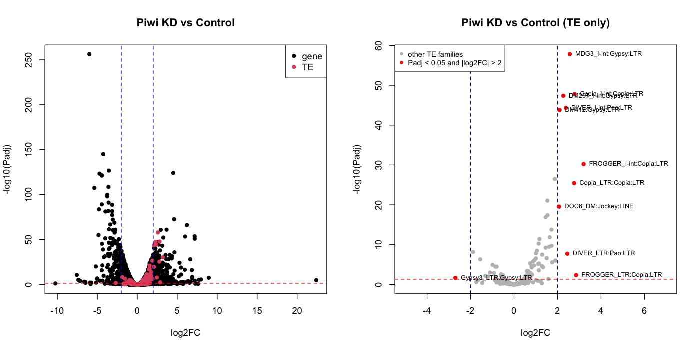

# Practical 4: Measuring differential expression of Transposable Elements with `TEtranscripts`

**Tutorial Author:** Clément Goubert (`goubert.clement@gmail.com`)

**Last Update**: November 5, 2026 (`TEtranscripts` 2.2.4, `STAR` 2.7.10b)

## Description

In this practical session, we will perform a differential expression analysis (statistical measurement of change in mRNA levels between conditions) of *Drosophila melanogaster*'s TEs after knockdown (KD) of Piwi,
the main gene involved in the Piwi-associated silencing complex (piRISC) which silences TEs in the Drosophila ovary.


> Figure 1. The pi-RISC complex in *D. melanogaster*, adapted from [Onishi et al., 2021](https://doi.org/10.15252/embr.202153062)

This tutorial is adapted from the demonstration of `TEtranscripts` by [Jin and Hammell (2018)](https://link.springer.com/book/10.1007/978-1-4939-7710-9). Since then, `DESeq2`, the program that performs the differential expression analysis, requires replicates for each condition. Thus, we have "upgraded" the analysis to use a new dataset from [Ilyin et al., 2021](https://www.mdpi.com/1422-0067/22/24/13430), as well as more recent reference genome (dm6) and TE annotations.

In their experiments, Ilyin et al., investigate the interaction between Piwi and HP1a for the repression of TEs in the ovaries of *D. melanogaster*. For this tutorial, we will only focus on the Piwi knock-down (Piwi-KD) vs control datasets, in order to see what happens when this key protein is not produced.

The main challenge with TE RNA-seq is the abundance of ambiguous reads which can map equally to different TE copies. This challenge is illustrated in the following figure:


> Figure 2. Origin of multi-mapping reads in TE-RNAseq. From [Lanciano and Cristofari (2020)](https://www.nature.com/articles/s41576-020-0251-y).

Different strategies exist to map and quantify TE expression, and I encourage those who would like to know more about it to read [this 2020 review by Lanciano and Cristofari](https://www.nature.com/articles/s41576-020-0251-y). We will discuss the solution used by the software `TEtranscripts` which uses a reference-genome approach (vs. reference transcriptome or hybrid approach). The key idea is to first identify multi-mapping reads, and then attempt to assign them to a unique locus. If the read can't be assigned unambiguously, then its weight (w = 1), will be equally distributed to all competing (n) loci (w = 1/n). Then, an Expectation-Maximization algorithm, will iteratively use information from uniquely mapped reads to find the most likely loci (or best set of loci) of origin. In the end, `TEtranscripts` will sum the weights (normalized counts) of uniquely and multi-mapping reads to the most suitable TE family (Family-level quantification). This family-level approach has been proven to be reliable, with high reproducibility. Note that other methods such as [SQuIRE](https://academic.oup.com/nar/article/47/5/e27/5280934) or [TElescope](https://journals.plos.org/ploscompbiol/article?id=10.1371/journal.pcbi.1006453) have been developed to estimate TE abundances via EM-algorithms at the locus level. Another notable method is [Cello-seq](https://www.nature.com/articles/s41587-021-01093-1), which allows TE DE analysis at the copy level AND in single-cell data!


> Figure 3. Simplified representation of algorithms using read-mapping to a reference genome. The red boxes mark the parts specific to `TEtranscripts`. Adapted from [Lanciano and Cristofari (2020)](https://www.nature.com/articles/s41576-020-0251-y).

### Objectives

1. Align RNA-seq reads to the *D. melanogaster* reference genome with `STAR` aligner
2. Estimation of relative transcript abundance with `TEtranscripts`
3. Statistical Differential Expression (DE) analysis with `TEtranscripts`

## Protocol

### Working directory set-up

`STAR`, `TEtranscripts` and `R` with `DESeq2` are in the conda environment `tetranscripts`. Activate it first:

```
conda activate tetranscripts
```

We set up a working directory that will host our results

```
mkdir practical4
cd practical4
```
Next, we create a symbolic link to the input data. This allows us to work as if the data were located in the same working directory (like in real life!).

```
ln -s /data/practical4_tetranscripts/input_data/ input_data
```

### Input data

Let's first look at the input data, located in the shared folder of the course server

```
tree input_data/
```

```
input_data/
├── Control_rep_1.fastq.gz      # --> control RNA-seq reads, replicate 1
├── Control_rep_2.fastq.gz      # --> control RNA-seq reads, replicate 2
├── Piwi_GKD_rep_1.fastq.gz     # --> Piwi KD RNA-seq reads, replicate 1
├── Piwi_GKD_rep_2.fastq.gz     # --> Piwi KD RNA-seq reads, replicate 2
├── dm6.ensGene.gtf             # --> dm6 genes annotation
├── dm6.fa                      # --> dm6 reference genome
└── dm6_rmsk_TE.gtf             # --> dm6 TE annotation

1 directory, 7 files
```
>Note: for future use, check details about the `gtf` files required for `TEtranscripts` [here](https://hammelllab.labsites.cshl.edu/software/#TEtranscripts), and a way to convert `.gff` to `.gtf` [here](https://www.biostars.org/p/45791/)

### Step 1: Align RNA-seq to the reference genome

#### 1.1 The STAR index for the dm6 reference genome

`STAR` first needs an index of the reference genome. With `--sjdbGTFfile`, the index also stores the splice junctions of the gene annotation. Building the index took about 7 minutes and 5.5 GB of memory in our tests. With 20 students building it at once, the course server would run out of memory, so we built one index for everyone with this command (**do not run it**):

```
STAR --runMode genomeGenerate --genomeDir Index --genomeFastaFiles input_data/dm6.fa --sjdbGTFfile input_data/dm6.ensGene.gtf --sjdbOverhang 100 --runThreadN 2 --genomeSAindexNbases 12
```

Link the shared index into your working directory instead:

```
ln -s /data/practical4_tetranscripts/Index/ Index
```

#### 1.2 align the reads

With the index created, we can now **map the RNA-seq reads for the control and KD conditions**. Because `TEtranscripts` relies on differences between **uniquely mapping** and **multi-mapping reads**, we will use specific parameters of the `STAR` aligner to allow it (`--winAnchorMultimapNmax` and `--outFilterMultimapNmax`). The index already holds the splice junctions of the gene annotation, so the alignment commands do not need the `gtf` file.

#### 1.2.1 Treatment (2 replicates)
```
mkdir STARalignments
STAR --runThreadN 2 --genomeDir Index --readFilesIn input_data/Piwi_GKD_rep_1.fastq.gz --readFilesCommand zcat --outSAMtype BAM Unsorted --winAnchorMultimapNmax 200 --outFilterMultimapNmax 100 --outFileNamePrefix STARalignments/piwiKD1_
```
>note: each alignment should take about 30 seconds

```
STAR --runThreadN 2 --genomeDir Index --readFilesIn input_data/Piwi_GKD_rep_2.fastq.gz --readFilesCommand zcat --outSAMtype BAM Unsorted --winAnchorMultimapNmax 200 --outFilterMultimapNmax 100 --outFileNamePrefix STARalignments/piwiKD2_
```

#### 1.2.2 Control (2 replicates)
```
STAR --runThreadN 2 --genomeDir Index --readFilesIn input_data/Control_rep_1.fastq.gz --readFilesCommand zcat --outSAMtype BAM Unsorted --winAnchorMultimapNmax 200 --outFilterMultimapNmax 100 --outFileNamePrefix STARalignments/piwiCT1_
```
```
STAR --runThreadN 2 --genomeDir Index --readFilesIn input_data/Control_rep_2.fastq.gz --readFilesCommand zcat --outSAMtype BAM Unsorted --winAnchorMultimapNmax 200 --outFilterMultimapNmax 100 --outFileNamePrefix STARalignments/piwiCT2_
```

### Step 2: Run TEtranscripts to perform counts and differential expression analysis

```
TEtranscripts --format BAM --stranded reverse -t STARalignments/piwiKD1_Aligned.out.bam STARalignments/piwiKD2_Aligned.out.bam  -c STARalignments/piwiCT1_Aligned.out.bam STARalignments/piwiCT2_Aligned.out.bam --GTF input_data/dm6.ensGene.gtf --TE input_data/dm6_rmsk_TE.gtf --mode multi --project piwiKD_vs_control --minread 1 -i 10 --padj 0.05
```

> `TEtranscripts` prints the message `[E::idx_find_and_load] Could not retrieve index file for 'STARalignments/piwiKD1_Aligned.out.bam'` once for each BAM file. It reads the BAM files without an index, so you can ignore the message.
> `TEtranscripts` should take about 4 minutes to run.

While `TEtranscripts` is running, you can look into the detailed workflow. You will see that the program alternated between gathering reads from each alignments and performing the Expectation/Maximization step attributing reads to TE loci.


> Figure 4. The `TEtranscripts` flow chart, from Figure 1 of [Jin et al., 2015](https://doi.org/10.1093/bioinformatics/btv422).


### Results

After a successful run, 4 files will be generated:

- `piwiKD_vs_control.cntTable`: this is the read counts out of `TEtranscripts`, for both genes and TEs. `TEtranscripts` writes the column names on the first line, `gene/TE` and then the BAM files, with `.T` added to the treatment (`-t`) files and `.C` to the control (`-c`) files. In the next lines, the first column is the gene or TE family name, and each next column is the read count in one BAM file.

    ```
    head piwiKD_vs_control.cntTable
    ```

    ```
    gene/TE STARalignments/piwiKD1_Aligned.out.bam.T    STARalignments/piwiKD2_Aligned.out.bam.T    STARalignments/piwiCT1_Aligned.out.bam.C    STARalignments/piwiCT2_Aligned.out.bam.C
    "FBgn0000003"   9067    0   15412   5975
    "FBgn0000008"   32  28  47  59
    "FBgn0000014"   80  75  25  19
    "FBgn0000015"   8   5   1   2
    "FBgn0000017"   158 207 115 153
    "FBgn0000018"   27  21  29  27
    "FBgn0000022"   1   0   0   0
    "FBgn0000024"   7   8   2   2
    "FBgn0000028"   1   0   0   0
    ```
    >*D. melanogaster* genes all have the `FBgn` prefix
    ```
    tail piwiKD_vs_control.cntTable
    ```

    ```
    TV1I:Gypsy:LTR  5   8   7   5
    Tn1000:ARTEFACT:ARTEFACT    0   0   0   0
    Transib-N1_DM:CMC-Transib:DNA   2   2   1   3
    Transib5:CMC-Transib:DNA    10  9   9   13
    UHU:TcMar-Tc1:DNA   0   0   0   0
    Ulysses_I-int:Gypsy:LTR 2   5   1   0
    XDMR:XDMR:Unknown   0   2   2   4
    XDMR_DM:XDMR_DM:Unknown 3   1   0   0
    ZAM_I-int:Gypsy:LTR 8   9   4   6
    ZAM_LTR:Gypsy:LTR   0   2   6   6
    ```

- `piwiKD_vs_control_gene_TE_analysis.txt`: this is the main result table from the differential expression analysis with `DESeq2`.

    ```
    head piwiKD_vs_control_gene_TE_analysis.txt
    ```

    ```
    baseMean    log2FoldChange  lfcSE   stat    pvalue  padj
    FBgn0000003 7496.95757369845    -1.31588110563333   3.91517818121716    -0.336097374047033  0.736797438570344   0.902931518055443
    FBgn0000008 41.2458985575463    -0.846114063691264  0.467066243124928   -1.81155045166677   0.0700556868130839  0.241023513710386
    FBgn0000014 49.1313822401896    1.7929156372435 0.452335730143835   3.96368342751386    7.38021080032262e-05    0.00106796762682466
    FBgn0000015 3.92383069032185    2.0829306438596 1.49150705492375    1.39652751690543    0.162555700265905   0.417269675434786
    FBgn0000017 157.368973080098    0.429978356404668   0.309421779996998   1.38961890920814    0.164644630647959   0.420488967363299
    FBgn0000018 25.7694398739735    -0.249911503927691  0.563685400677301   -0.443352805709368  0.657510566365039   0.864827023599609
    FBgn0000024 4.70396606917908    1.88748067967958    1.33686327312379    1.41187264069959    0.157987464852245   0.411090346902346
    FBgn0000032 50.7888758887039    -0.532154144950741  0.431633506310109   -1.23288423435879   0.217618958246636   0.501856114045118
    FBgn0000042 968.973315255412    0.248614008243223   0.200030390371073   1.24288118311434    0.213911620665748   0.496931272758441
    ```

    ```
    tail piwiKD_vs_control_gene_TE_analysis.txt
    ```

    ```
    TRANSPAC_I-int:Gypsy:LTR    116.426050473781    2.06078095694532    0.331629170735864   6.21411244485091    5.16155578471022e-10    3.50426624816952e-08
    TRANSPAC_LTR:Gypsy:LTR  12.1095419528461    1.76623368239437    0.849805377205591   2.07839786587638    0.0376727291224817  0.156511843019305
    TV1I:Gypsy:LTR  6.23072662936149    0.102213533552676   1.10071009655522    0.0928614481438518  0.92601363328503    0.974867498620109
    Transib-N1_DM:CMC-Transib:DNA   1.98528756375055    -0.0223984610856636 1.90043922606137    -0.0117859391547522 0.990596398820838   NA
    Transib5:CMC-Transib:DNA    10.1712918148752    -0.23604054717197   0.86777359351202    -0.272007063751129  0.78561658797219    0.92853885713179
    Ulysses_I-int:Gypsy:LTR 2.00223081782135    2.80426441522326    2.27755371421552    1.23126159340183    0.21822504139964    NA
    XDMR:XDMR:Unknown   2.01154637645356    -1.57585504037125   2.06147233134796    -0.764431817205533  0.444609954097204   NA
    XDMR_DM:XDMR_DM:Unknown 0.966447687607186   3.3967698641132 2.98207321047951    1.13906320347078    0.254676793573656   NA
    ZAM_I-int:Gypsy:LTR 6.69679800635913    0.745646271117691   1.06771550749756    0.698356693221853   0.484954152480517   0.761403253085136
    ZAM_LTR:Gypsy:LTR   3.51204812393295    -2.58361615300062   1.69247114490964    -1.52653483090168   0.126876722901108   0.358559982440447
    ```
    >REMINDER: with `TEtranscripts`, the results are given at the TE family level

- `piwiKD_vs_control_sigdiff_gene_TE.txt` is the same table, filtered for significant genes or TE families only (according to the threshold set in the `TEtranscripts` command)

- `piwiKD_vs_control_DESeq2.R` is a `R` script that can be used to replicate the DE analysis, changing parameters, etc... Without re-running the read counting step of `TEtranscripts`


#### Plot the results as a volcano plot!

Before analyzing the results, create a symlink to the actual results, made out of the complete read-sets.

```
ln -s /data/practical4_tetranscripts/results/ results
```

A few guidelines:
- Volcano plot represent the relationship between log2-fold-change (log2FC), i.e. the intensity of the change, and the significance of the change (P-value)
- We will use the adjusted P-value (Padj < 0.05) for our P-value significance threshold
    - It is more handy to represent the adjusted P-value as -log10(Padj), such as the more significant, the higher the value.
- We will use |log2FC| > 2 (a change of more than 4 times, up or down) for our fold-change significance. This threshold is empirically supported by qPCR validation.

Use the table `results/piwiKD_vs_control_gene_TE_analysis.txt` and the tool of your choice to generate volcano plots. Below is an example made with base `R`; the code is at the end of this section. Excel is more than OK!

To transfer files from the server to your computer:

1. Open a new terminal tab or window
2. From this new tab, copy the result table to the folder you are in on your computer:

    ```
    scp -i <KEY>.pem <USER>@<SERVER_IP>:practical4/results/piwiKD_vs_control_gene_TE_analysis.txt .
    ```

    Replace `<KEY>.pem` with your key file, `<USER>` with your user name on the server, and `<SERVER_IP>` with the server address you receive on the day of the class. You can then open the table from your file explorer.
3. Alternatively, you can use FileZilla to transfer the output table.


> Figure 5. Volcano plots of the Piwi-KD vs control comparison. Left: all genes and TE families. Right: TE families only; in red, those with Padj < 0.05 and |log2FC| > 2. Made with `VolcanoPiwi.R` from the results in `results/`.

As expected, upon KD of Piwi, several TE families became transcriptionally active in the ovaries!

The `R` code for these plots is in `VolcanoPiwi.R`. To run it on the server, from your `practical4` directory:

```
cp /data/practical4_tetranscripts/VolcanoPiwi.R .
Rscript VolcanoPiwi.R
```

`Rscript` writes the two plots to `Rplots.pdf`. Copy it to your computer with `scp`, as above, using `practical4/Rplots.pdf` as the file to copy.

🎉 **Success!!!** Now you are an expert in TE differential expression analysis!
